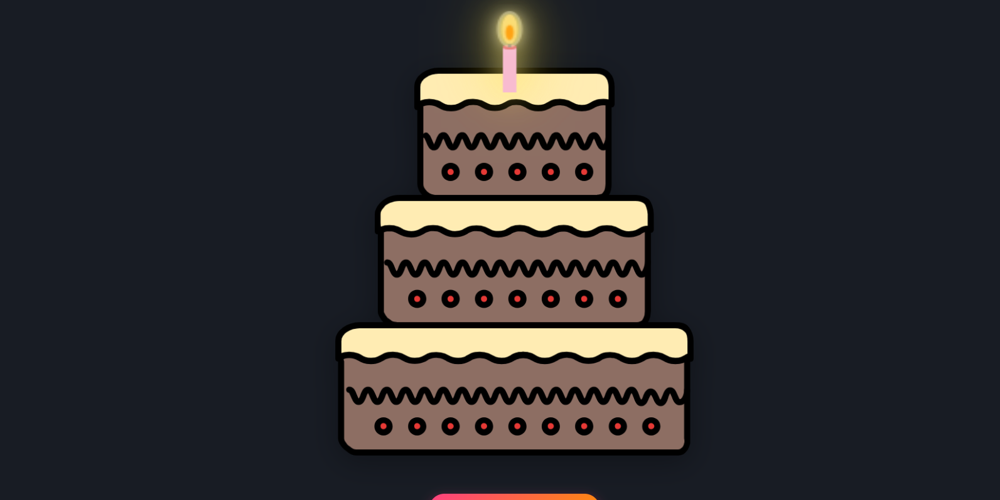
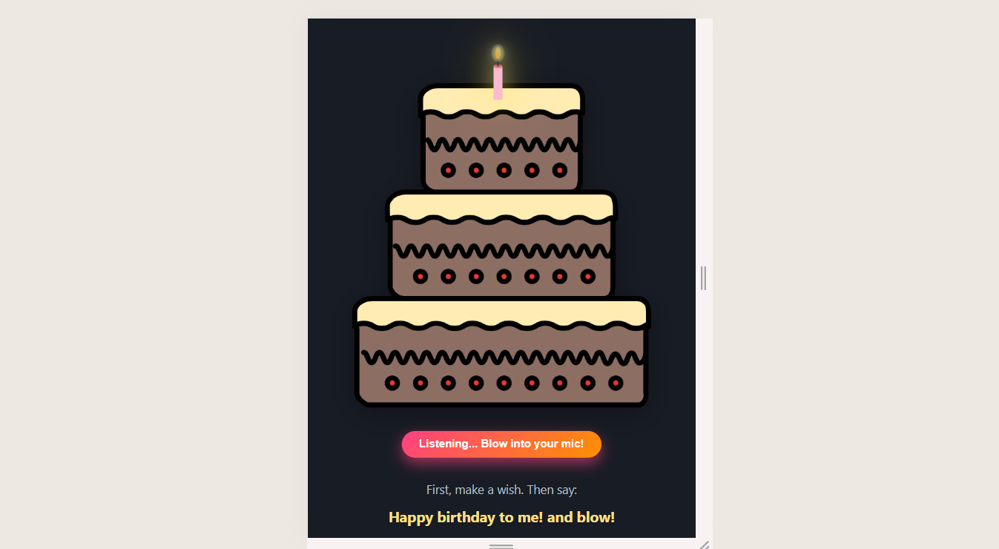
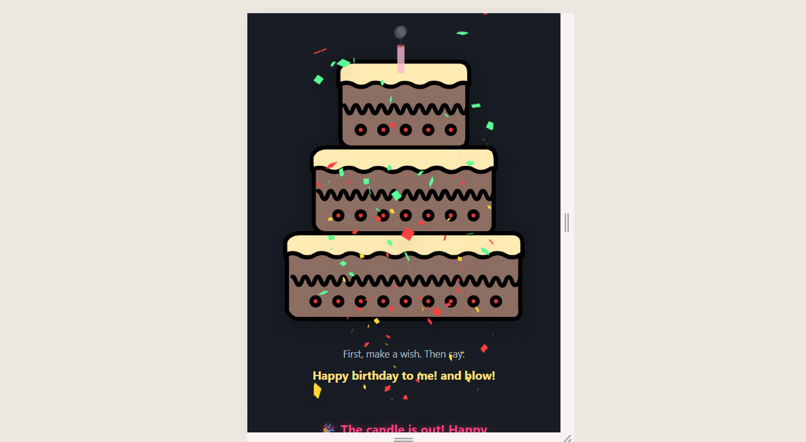
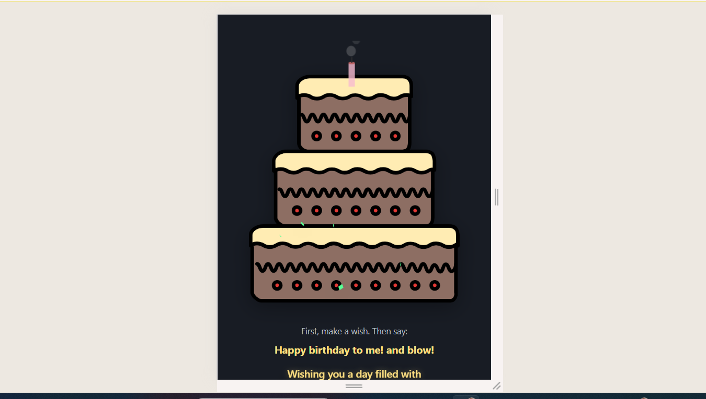

🎂 Birthday Cake — Blow the Candle 🕯️

      
 
 <strong>🎉 Make a wish. Say "Happy Birthday!" and blow out the candle! 🎂</strong> 
 
 <a href="https://birthday-kohl-nine.vercel.app/"> 🎈 <strong>Live Demo</strong> 🎈 </a> 

✨ About The Project

Birthday Cake — Blow the Candle is a fun and interactive birthday web experience.

Instead of simply clicking a button, you can blow out the virtual candle using your voice. Once the candle goes out, the celebration begins with music, animations, and confetti. 🎉

It is designed to make remote birthday celebrations a little more fun and memorable. ❤️

🎯 How It Works

🎂 Open the birthday cake.

💭 Make a wish.

🎙️ Say "Happy Birthday!" and blow.

🕯️ The virtual candle goes out.

🎵 Birthday music starts.

🎉 Confetti and celebration animations appear.

🔄 Restart and celebrate again!

🌟 Features
Feature	Description
🎙️ Voice Control	Uses the Web Speech API to detect voice commands
🕯️ Interactive Candle	Blow out the virtual birthday candle
🎵 Birthday Music	Plays a birthday celebration track
🎉 Confetti	Celebration effects after the candle is blown out
✨ Animations	Smooth visual effects using Lottie and Canvas
📱 Responsive Design	Works across desktop, tablet, and mobile devices
🔄 Restart	Start the birthday celebration again
🎨 Customizable	Easily customize the cake, messages, audio, and styling
🛠️ Tech Stack
Frontend

HTML5

CSS3

JavaScript (ES6+)

APIs & Libraries

🎙️ Web Speech API — voice recognition

🎨 Canvas API — candle and visual effects

✨ Lottie Web — celebration animations

🎵 HTML5 Audio — birthday music

Deployment

▲ Vercel

📸 Preview

  
 
    

🚀 Live Demo

Experience the project here:

🎂 Celebrate Now →

💡 For the best experience, allow microphone access when your browser asks for permission.

💻 Run Locally
1. Clone the repository
git clone https://github.com/Govind1002/Birthday-Cake-Blow-Candle.git

2. Open the project
cd Birthday-Cake-Blow-Candle

3. Run the project

You can open index.html directly in your browser.

For the best experience, use a local development server such as VS Code Live Server.

📂 Project Structure
Birthday-Cake-Blow-Candle/
│
├── 📂 audio/
│   └── 🎵 birthday.mp3
│
├── 📂 css/
│   └── 🎨 styles.css
│
├── 📂 img/
│   ├── 🎂 cake.png
│   ├── 📸 preview.png
│   ├── 📸 preview1.png
│   ├── 📸 preview2.png
│   ├── 📸 preview3.png
│   └── 📸 preview4.png
│
├── 📂 js/
│   └── 🕯️ candle_on_cake.js
│
├── 📄 index.html
├── 📄 LICENCE
└── 📄 README.md

🎨 Customization

You can easily personalize the project by modifying:

🎂 Cake image

🕯️ Candle design

💌 Birthday messages

🎵 Birthday music

🎨 Colors and animations

🎉 Celebration effects

🔘 Button styles

Change the Birthday Message

Open:

index.html

and customize the message inside the greeting section.

For example:

  Wishing you happiness, success and lots of beautiful moments.
  Happy Birthday! 🎂❤️

🌐 Browser Support

The voice-control feature depends on browser support for the Web Speech API.

For the best experience, use a modern browser such as:

Google Chrome

Microsoft Edge

Safari

🎙️ Microphone permission may be required for voice interaction.

🤝 Contributing

Contributions are welcome! ❤️

If you have an idea to improve the project:

Fork the repository.

Create a new branch.

Make your changes.

Commit your changes.

Open a Pull Request.

git checkout -b feature/your-feature
git commit -m "Add your feature"
git push origin feature/your-feature

💡 Ideas for Future Updates

Some features that could be added in the future:

🎁 Personalized birthday names

🎨 Multiple cake designs

🕯️ Multiple candle modes

🌈 Custom themes

📱 Better mobile interactions

🎤 Improved voice recognition

🎵 Multiple birthday songs

🔗 Shareable personalized birthday links

👨‍💻 About

Made with ❤️ and JavaScript by Govind.

I enjoy building interactive web experiences that combine creativity, design, and code.

If you like this project, consider giving it a ⭐ on GitHub!

🔗 Connect

  

📜 License

This project is licensed under the MIT License.

See the LICENCE file for more information.

 🎂 <strong>Make a wish. Blow the candle. Celebrate! 🎉</strong> 🕯️ 
